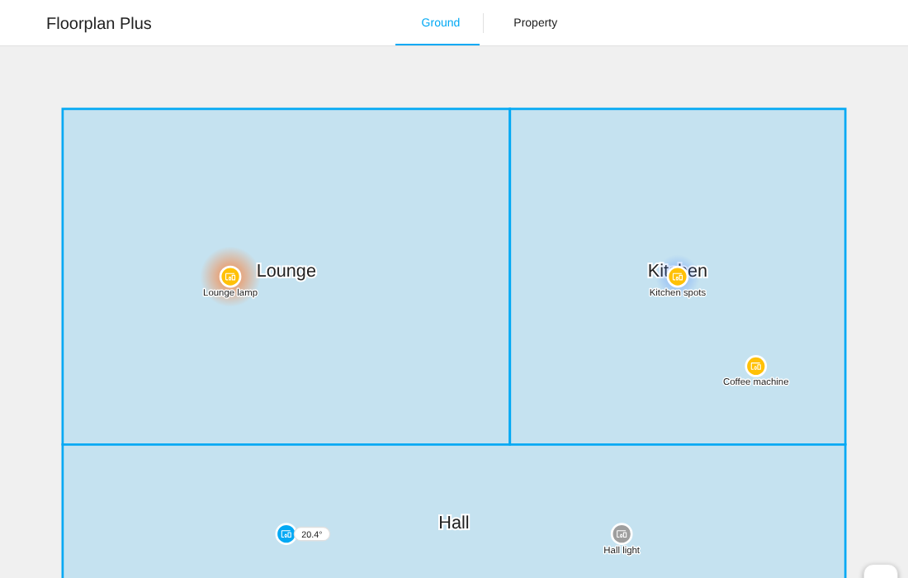
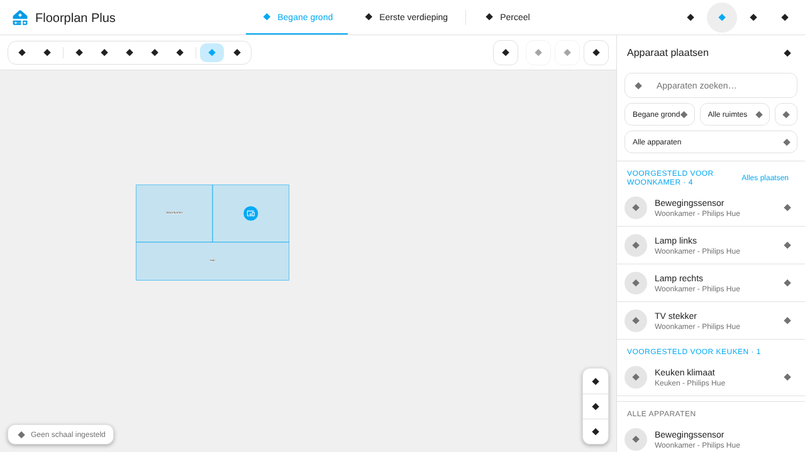
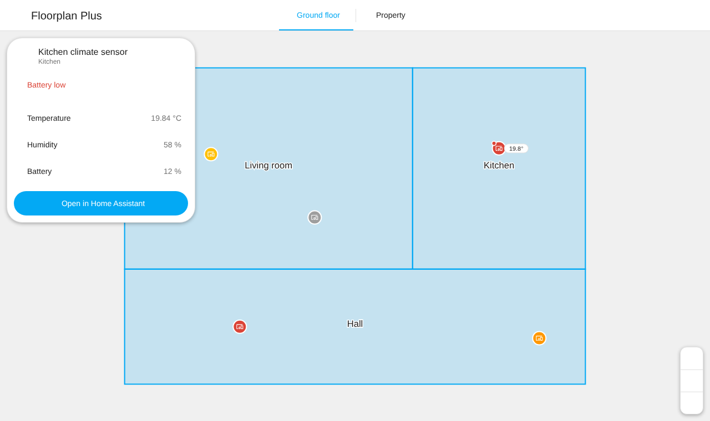
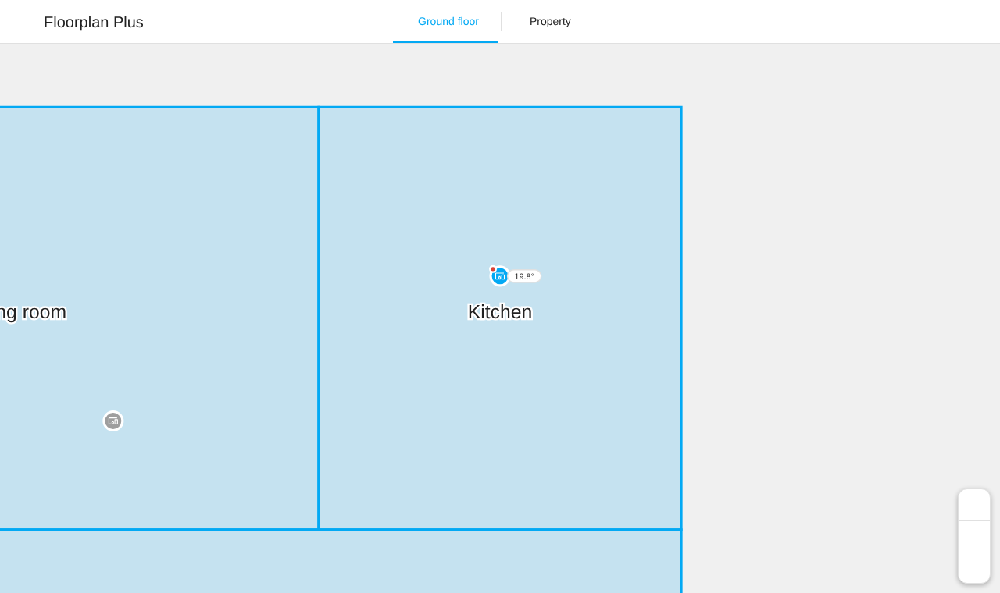
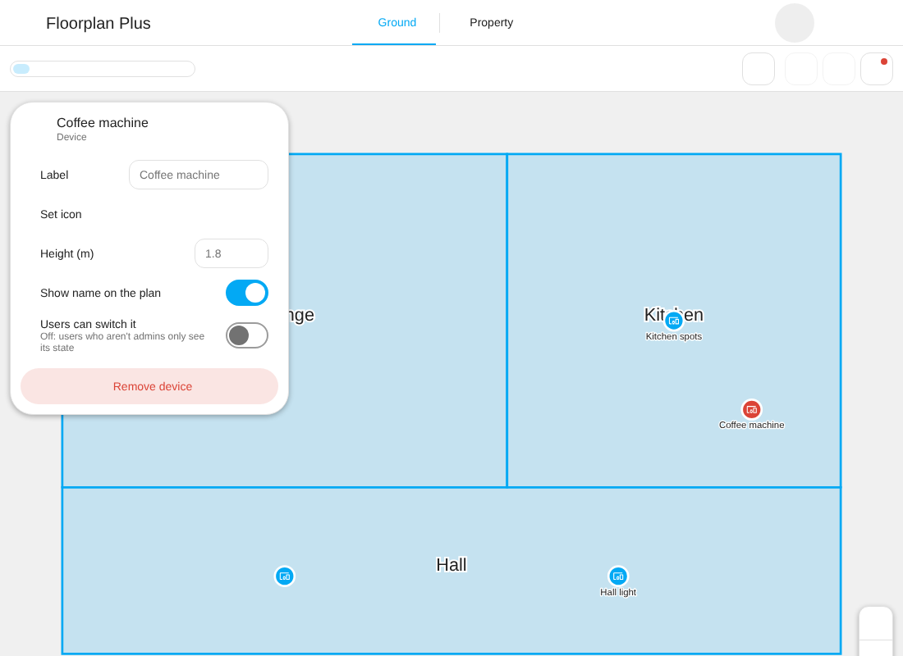
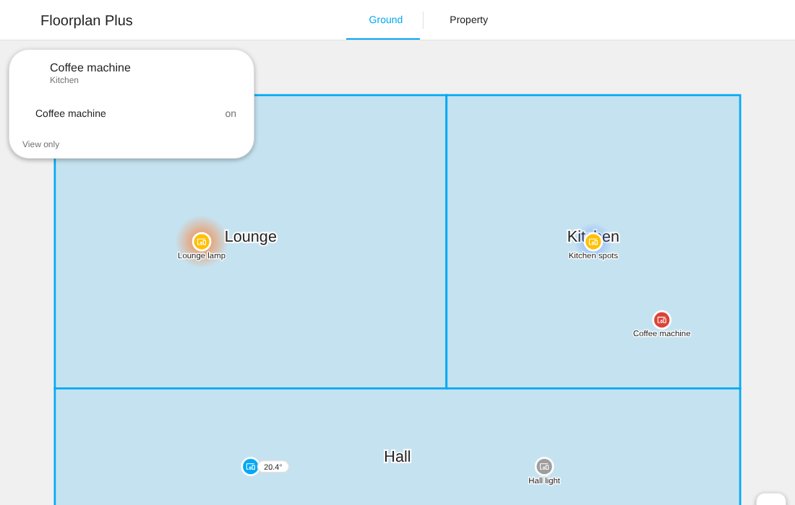
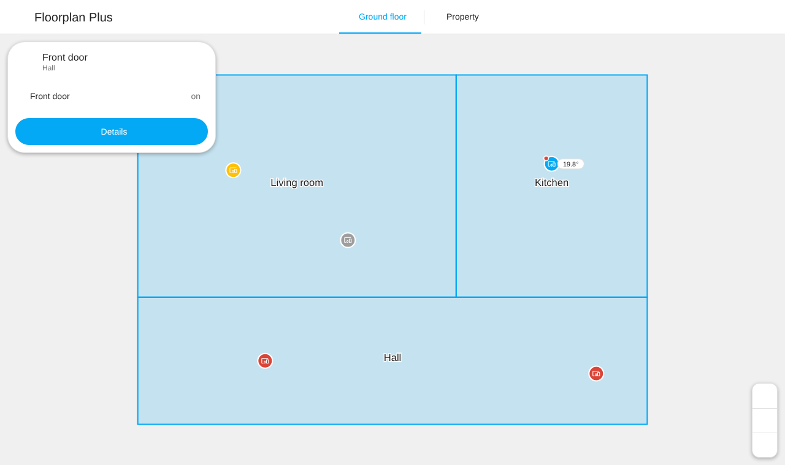
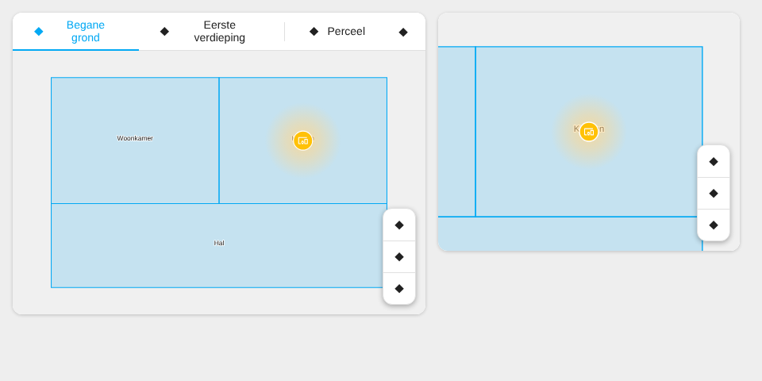

<p align="center">
  <picture>
    <source media="(prefers-color-scheme: dark)" srcset="custom_components/floorplan_plus/brand/dark_logo.png">
    
  </picture>
</p>

# Floorplan Plus

A floor plan for Home Assistant that is quick to click together and pleasant to look at every day. Trace your rooms over a picture of your floor plan, place your real devices on it, and see at a glance which lights are on, which windows are open and what the temperature is in each room. Everyone in the house can use it; only admins can change it.



Floorplan Plus is a fork of [Spatial Context](https://github.com/Greminn/ha-spatial-context) by Greminn, which does the editing, the Zigbee and Wi-Fi network layers and the property view. This fork adds what we need for daily use:

- **A view mode for everyone.** Every Home Assistant user can open the plan. Only admins can edit it.
- **Live state on the plan.** Lights glow in their own colour when they're on, and temperature, doors and windows, motion, battery and offline devices show at a glance.
- **Per-device permissions.** Admins choose, per device, whether other users can switch it or only see its state.
- **Names on the plan** for the devices you choose, and lights drawn as a light bulb.
- **Tap through to Home Assistant.** Tap a device for its states and quick toggles, and open it in Home Assistant.
- **Zoom to a room** when you tap it, and a **home button** to glide back to the whole plan.
- **A dashboard card** for wall tablets and phones.
- **Suggested devices per room.** Link a room to a Home Assistant area and its devices are offered first, ready to drop into the room in one click.
- **Your Home Assistant language.** English, Dutch and German.

It is installed under its own name (`floorplan_plus`), so it can sit next to Spatial Context without clashing.

## Installation

Needs **Home Assistant 2024.10** or newer, with your floors set up in **Settings → Areas → Floors**.

[](https://my.home-assistant.io/redirect/hacs_repository/?owner=definexperience&repository=ha-floorplan-plus&category=integration)

1. Click the button above, or in HACS choose **⋮ → Custom repositories**, paste `https://github.com/definexperience/ha-floorplan-plus` and set **Type** to **Integration**.
2. Find **Floorplan Plus** in HACS and choose **Download**.
3. Restart Home Assistant (**Settings → System → ⏻ → Restart Home Assistant**).
4. Go to **Settings → Devices & Services → Add Integration → Floorplan Plus**.
5. Refresh your browser. **Floorplan Plus** now appears in the sidebar, and the card in the dashboard card picker.

Prefer to copy files by hand? Put `custom_components/floorplan_plus/` into your `/config/custom_components/` and restart.

### Updating

1. HACS shows an update for **Floorplan Plus**. Open it and choose **Update** (or **⋮ → Redownload** to pick a version).
2. Restart Home Assistant. The panel shows a reminder until you do, because some changes won't save before the restart.
3. Refresh every browser and tablet that shows the plan: a hard refresh on a computer (Ctrl+F5, or Cmd+Shift+R on a Mac), pull down on a phone. If the Home Assistant Companion app keeps showing the old version, use **Reset frontend cache** in the app's own settings (under **Settings → Companion app**, then Troubleshooting or Debugging).

If a dashboard shows *Custom element doesn't exist: floorplan-plus-card*, Home Assistant hasn't been restarted yet or the browser still has the old page. Restart and refresh.

### Coming from the old repository name

This repository used to be called `ha-spatial-context`. GitHub forwards the old address, but HACS works best with the current one:

1. In HACS, open **Floorplan Plus** and choose **⋮ → Remove** (this removes the HACS entry; your floor plans stay, they are stored in Home Assistant).
2. **⋮ → Custom repositories**: remove `definexperience/ha-spatial-context` and add `https://github.com/definexperience/ha-floorplan-plus` as an **Integration**.
3. Download **Floorplan Plus** again and restart Home Assistant. You don't need to add the integration again.

## Using it

### Drawing your plan (admins)

1. Open **Floorplan Plus** from the sidebar and pick a floor tab.
2. Add a background image, then **Set Scale** by clicking two points a known distance apart.
3. **Trace Room** and **Trace Wall**, then **Place Device** to drop your devices on the plan.
4. Repeat for each floor, use **Align Floors** for floors that stack, and place buildings on the **Property** tab.

Changes save automatically. Editing works the same as in Spatial Context, so its [user guide](https://greminn.github.io/ha-spatial-context/) applies: [your first floor plan](https://greminn.github.io/ha-spatial-context/guide/first-floor-plan), [placing devices](https://greminn.github.io/ha-spatial-context/guide/placing-devices), the [Connectivity Map](https://greminn.github.io/ha-spatial-context/guide/connectivity-map) and the [Property tab](https://greminn.github.io/ha-spatial-context/guide/property-tab).

### Suggested devices per room

Link a room to a Home Assistant area: select the room and pick it under **Area**. When you **Place Device**, the devices in that area that aren't on the plan yet are listed first under *Suggested for* that room. Place one, or choose **Place all** to drop them all inside the room at once. Select a room first to see only its suggestions.



### Looking at the plan (everyone)

Users who aren't admins get the same plan in view mode: no editing tools, just the house with its live states.

- **Tap a room** to zoom in on it. The **home button** in the zoom controls glides back to the whole plan.
- **Tap a device** to see its states, switch it, or open it in Home Assistant.
- **Lights** are drawn as a light bulb (unless you picked another icon) and glow in their own colour when they're on. The brighter the light, the wider the glow.
- Temperature, doors and windows, motion, low batteries and offline devices are shown on the device markers.

| Device card | Zoomed in on a room |
|---|---|
|  |  |

### Device options (admins)

Tap a placed device while editing to set:

- **Show name on the plan.** Draws the device's name under its marker. Off by default.
- **Users can switch it.** On by default. Turn it off and users who aren't admins only see the device's state: no switches and no Home Assistant dialog for it. Admins can always switch everything.

| Device options | What a user sees for a view-only device |
|---|---|
|  |  |

### Language

The panel and the card follow the language set in your Home Assistant profile. English, Dutch and German are included; other languages fall back to English.



## Dashboard card

Add the **Floorplan Plus** card to any dashboard (**Edit dashboard → Add card**, then search for Floorplan Plus). It shows the same plan as the sidebar with live states, and it is view only for everyone, so it is safe on a shared wall tablet. Tapping a device shows its states and switches, following the same per-device permissions. Editing always happens in the sidebar panel.



```yaml
type: custom:floorplan-plus-card
floor: ground_floor   # optional: the floor to open on
area: kitchen         # optional: zoom in on the room linked to this area
height: 450           # optional: card height in pixels
show_header: true     # optional: floor tabs and network layers
```

The card registers itself, so there is no dashboard resource to add. It appears in the card picker after the integration is set up and Home Assistant has been restarted; see [Updating](#updating) if it doesn't.

## Map data for automations

`floorplan_plus.get_map` returns the whole layout (floors, rooms, walls, doors, windows and every placed device in real units) as the action's response.

```yaml
actions:
  - action: floorplan_plus.get_map
    response_variable: home_map
```

The shape is described in [the original map data guide](https://greminn.github.io/ha-spatial-context/ai/map-data).

## Feedback

Found a bug, or have an idea? Please [open an issue](https://github.com/definexperience/ha-floorplan-plus/issues).

## Credits

Floorplan Plus is built on [Spatial Context](https://github.com/Greminn/ha-spatial-context) by Simon Buchanan ([Greminn](https://github.com/Greminn)). The floor plan editor, the Connectivity Map, the Property tab, the map data and most of what you see come from there. If the original is useful to you, you can [support its author](https://buymeacoffee.com/greminn). The original brand pack is kept in [`brand/spatial-context/`](brand/spatial-context/).

## Development and licence

Building, testing and releasing are covered in [docs/development.md](docs/development.md). The panel is built from `frontend/` (Lit and TypeScript) and the output is committed, so HACS and a manual copy need no build step.

[MIT](LICENSE), the same licence as the original. Copyright Simon Buchanan for Spatial Context, and definexperience for the Floorplan Plus changes.
